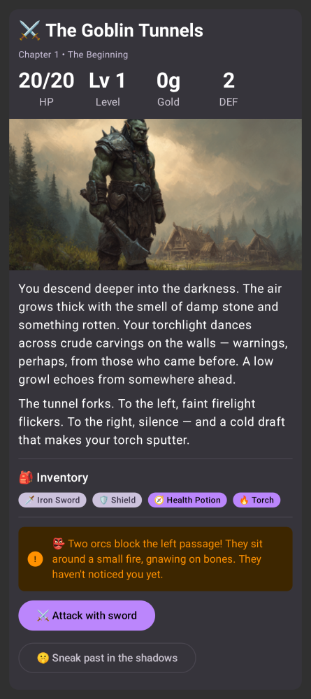
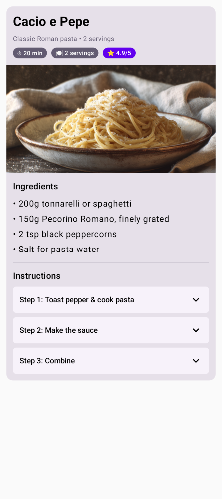
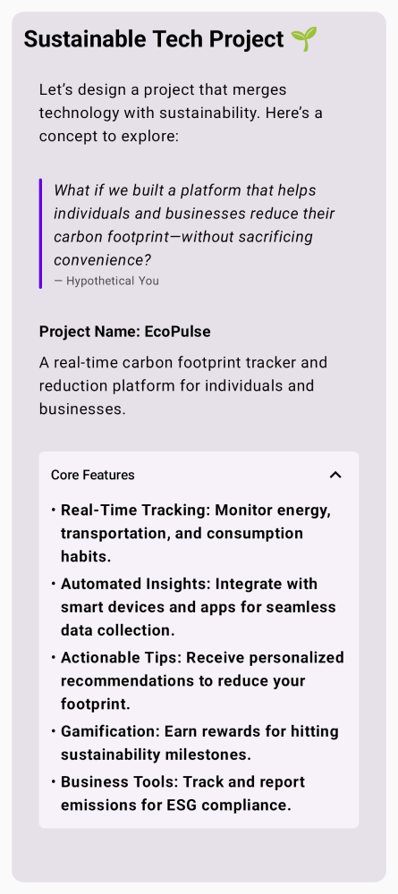
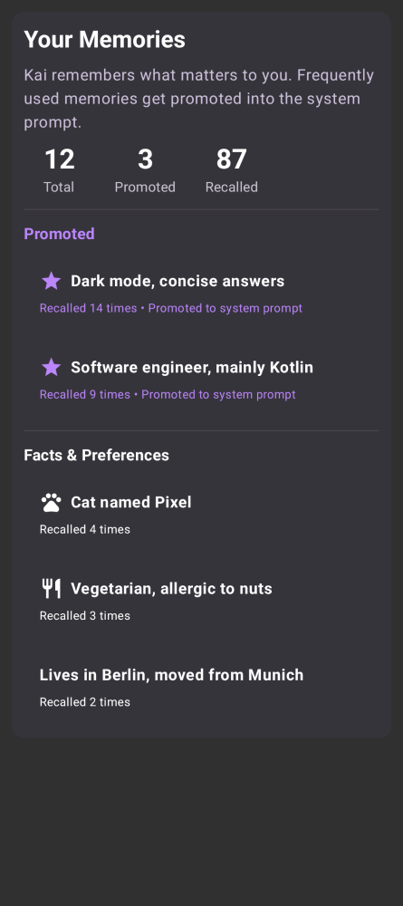
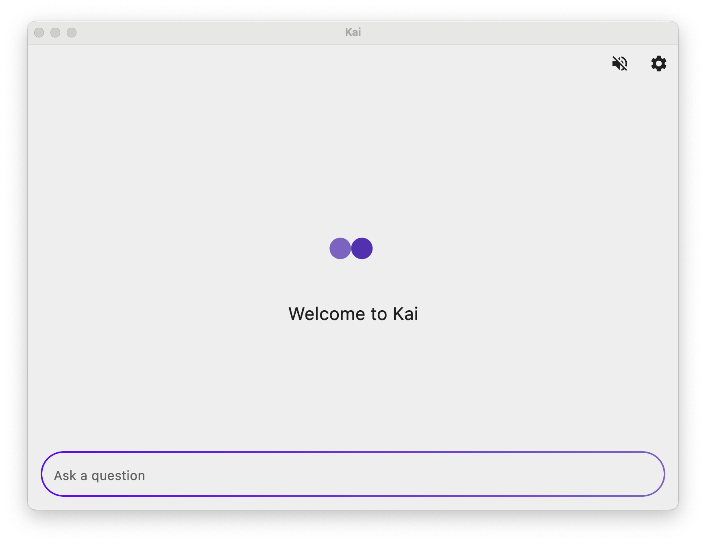
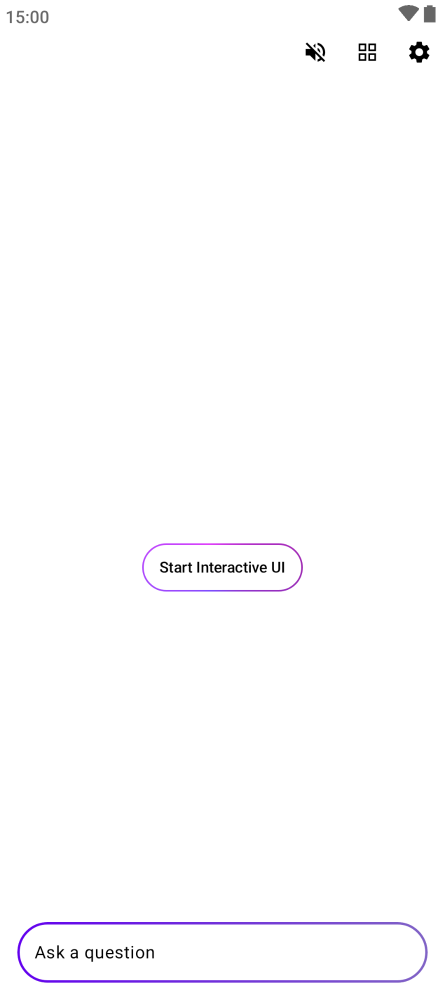
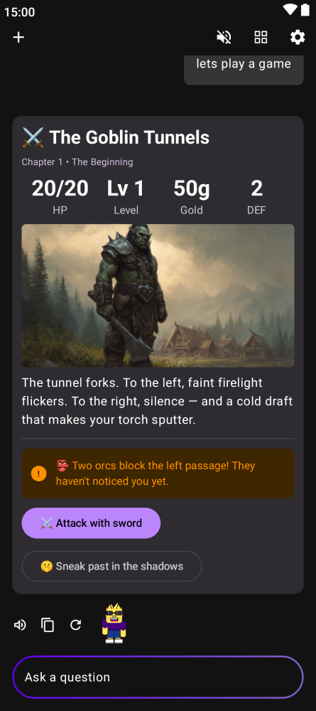

# Pots

<p align="center">
  
</p>

<p align="center">
  <b>Pots</b> — открытый ИИ-ассистент с постоянной памятью от компании <b>Pusi</b>.<br>
  Android · iOS · Windows · macOS · Linux · Web
</p>

<p align="center">
  <a href="https://github.com/pusi-os/pots">GitHub</a> ·
  <a href="https://github.com/pusi-os/pots/releases">Релизы</a> ·
  <a href="https://github.com/pusi-os/pots/issues">Issues</a> ·
  <a href="https://t.me/nerosekta">Telegram</a>
</p>

---

## О проекте

**Pusi** — компания, которая делает локально-ориентированные ИИ-продукты.
**Pots** — флагманское приложение Pusi: личный ассистент, который живёт на вашем
устройстве, помнит контекст, умеет работать с инструментами и не превращает
каждый ответ в стену текста.

Pots — это не «ещё один чат с ботом». Это среда, где ассистент:

- помнит факты, предпочтения и выводы между разговорами;
- строит интерактивные экраны и мини-приложения прямо в диалоге;
- работает с локальными моделями на устройстве или с облачными провайдерами;
- выполняет задачи по расписанию без вашего участия;
- может запускать Linux-песочницу и инструменты разработки на Android;
- остаётся рядом в образе Потсика — живого персонажа со своими состояниями.

Проект развивается как открытое ПО. Компания и продукт разделены явно:
**Pusi** — разработчик и владелец бренда, **Pots** — приложение.

## Ключевые возможности

### Память и персона
- Долговременная память: факты, предпочтения, ошибки и удачные решения.
- Память, которая доказала пользу, может подниматься в системный промпт.
- Редактируемая «душа» — характер и правила поведения ассистента.
- Несколько готовых характеров и возможность написать свой.

### Interactive UI и мини-приложения
- Ассистент генерирует кнопки, формы, таблицы, графики и целые экраны.
- **Мини-приложения** сохраняются в SQLite, имеют дерево версий, экспорт/импорт
  и отдельный пользовательский каталог файлов.
- Мини-приложение можно запустить отдельно от чата.
- Встроенный локальный веб-сервер отдаёт веб-приложения на телефоне.
- Декларативные коллекции, записи и автоматизации работают без отдельного
  скомпилированного бэкенда.

### Голос и персонаж
- **Потсик** — анимированный персонаж, нарисованный кодом, без Lottie и
  растровых кадров. Реагирует на состояние агента: ожидание, слушание,
  размышление, вызов инструмента, речь, ошибка.
- Настройки **Потсики**: внешний вид, костюмы, сцена, поведение.
- **HandsFree** — двусторонний голосовой диалог на системных STT/TTS.
  Сейчас реализован на Android; на других платформах распознавание речи
  может отсутствовать.
- Озвучивание ответов и управление речью.

### Модели и провайдеры
- 30+ облачных провайдеров и OpenAI-совместимые API.
- Автоматический fallback между сервисами.
- Локальные модели на Android через LiteRT — без интернета и API-ключей.
- Бесплатный уровень без обязательного ключа.
- Каталог моделей, контекстные окна, счётчики prompt/completion-токенов.
- MCP-серверы для подключения внешних инструментов.

### Инструменты и автоматизация
- Веб-поиск, уведомления, календарь, будильники, файлы.
- Shell, SSH, управление процессами.
- **Heartbeat** — периодическая самопроверка: задачи, почта и важные события.
  Если всё в порядке, ассистент молчит; если нужно внимание — уведомляет.
- Планировщик задач.
- **Pots Build** и Linux-песочница на Android: терминал, пакеты, Python,
  Node.js и агенты разработки.

### Данные и приватность
- История чатов хранится локально; на Android, iOS и desktop — в SQLite.
- Секреты и настройки — в защищённом хранилище платформы.
- На web история сохраняется в localStorage браузера.
- Нет обязательной регистрации, телеметрии и рекламных SDK.
- API-запросы уходят напрямую выбранному провайдеру.

## Платформы

| Платформа | Статус | Примечание |
|---|---|---|
| Android | Основная | LiteRT, HandsFree, Linux-песочница, Pots Build |
| iOS | Поддерживается | Keychain, локальные модели через LiteRT bridge |
| Windows / macOS / Linux | Поддерживается | Desktop JVM, TTS, локальные модели |
| Web (wasmJs) | Поддерживается | Без системного распознавания речи |
| ESP32-компаньон | В планах | Не реализован; не заявляйте обратное |

## Скриншоты

<p align="center">
  
  
  
  
</p>

<p align="center">
  
  
  
</p>

## Архитектура

Pots построен на Kotlin Multiplatform и Compose Multiplatform. Один общий
код UI и логики используется на Android, iOS, desktop и web; платформенные
различия спрятаны за `expect/actual`.

| Модуль | Назначение |
|---|---|
| `:composeApp` | Общая библиотека: UI, доменная логика, сеть, БД, модели |
| `:androidApp` | Тонкая Android-оболочка, flavors `foss` и `playStore` |
| `:iosApp` | Xcode-проект и Swift-мост к LiteRT |
| `:screenshotTests` | Paparazzi-эталоны и скриншоты для store/README |

Основные технологии:

- Kotlin Multiplatform, Compose Multiplatform
- Koin — DI
- Ktor — HTTP/SSE
- SQLDelight — локальная база
- LiteRT / LiteRT-LM — локальный инференс
- `nl.marc-apps:tts` — синтез речи
- FileKit — выбор файлов и вложений

Поток запроса верхнего уровня:

```text
UI → ViewModel → Chat/Agent → провайдер модели
                              ├─ локальный LiteRT
                              └─ облачный OpenAI-совместимый API
                                   ↓
                              инструменты / MCP
                                   ↓
                              память + SQLite
```

### Исходные каталоги

```text
composeApp/src/
  commonMain/      общий код и Compose UI
  androidMain/     Android actuals, сервисы, Linux-песочница
  iosMain/         iOS actuals, Keychain, LiteRT bridge
  desktopMain/     desktop actuals и окно приложения
  wasmJsMain/      web actuals и localStorage
  jvmShared/       общий JVM-код Android и desktop
  commonTest/      общие unit-тесты
  desktopTest/     JVM-тесты
```

## Быстрый старт

### Требования

- JDK 21 (обязательно для Paparazzi и актуального Android toolchain)
- Android SDK с API 37 для сборки Android
- Xcode — только для iOS
- Linux/macOS/Windows — для desktop

Проверьте Java:

```bash
java -version
```

При необходимости укажите JDK 21 в `~/.gradle/gradle.properties`:

```properties
org.gradle.java.home=/path/to/jdk-21
```

### Клонирование и проверка

```bash
git clone https://github.com/pusi-os/pots.git
cd pots
./gradlew spotlessApply
./gradlew :composeApp:desktopTest
```

### Запуск desktop-версии

```bash
./gradlew :composeApp:run
```

Release-проверка desktop (с ProGuard):

```bash
./gradlew :composeApp:runRelease
```

Чек-лист: `docs/desktop-release-smoketest.md`.

### Сборка Android

Debug:

```bash
./gradlew :androidApp:assembleFossDebug
```

APK появится в:

```text
androidApp/build/outputs/apk/foss/debug/
```

Release:

```bash
./gradlew :androidApp:assembleFossRelease
```

Для подписи release задайте переменные окружения:

```bash
export KEYSTORE_FILE=/absolute/path/to/release.keystore
export KEYSTORE_PASSWORD=...
export KEY_ALIAS=...
```

Без них release-сборка подписывается debug-ключом — это удобно для локальной
проверки, но не для публикации.

### Web

```bash
./gradlew :composeApp:wasmJsBrowserDistribution
```

Готовые файлы: `composeApp/build/dist/wasmJs/productionExecutable/`.

### Бесплатный уровень

Ключ бесплатного уровня не хранится в репозитории. Для локальной сборки его
можно положить в git-ignored `local.properties`:

```properties
pots.free.apiKey=...
```

Ключ, введённый пользователем в настройках, имеет приоритет над встроенным.

## Публикация APK

Для сборки релизного APK, отправки в дашборд и фиксации версии используется:

```bash
scripts/publish-apk.sh
```

Скрипт:

1. поднимает `versionName`/`versionCode`;
2. собирает `:androidApp:assembleFossRelease`;
3. проверяет подпись;
4. загружает APK и `manifest.json` на хост дашборда;
5. коммитит изменение версии.

Перед запуском убедитесь, что рабочее дерево чистое и настроены доступы к
хосту дашборда.

## Разработка

| Задача | Команда |
|---|---|
| Форматирование | `./gradlew spotlessApply` |
| Unit-тесты | `./gradlew :composeApp:desktopTest` |
| Android debug APK | `./gradlew :androidApp:assembleFossDebug` |
| Desktop | `./gradlew :composeApp:run` |
| Скриншоты README | `./gradlew :screenshotTests:updateScreenshots` |
| Store-скриншоты | `./gradlew :screenshotTests:generateStoreScreenshots` |
| Проверка миграций БД | входит в сборку (`verifyMigrations=true`) |

Правила для изменений:

- Схема SQLDelight меняется только вместе с новой numbered `.sqm`-миграцией.
- UI и поведение платформ проверяйте на реальном устройстве или эмуляторе.
- Секреты, ключи и `local.properties` не коммитятся.
- После изменения задокументированной области обновите `docs/features/<area>.md`
  и дату `Last verified`.
- Брендинг: **Pusi** — компания, **Pots** — приложение, **Потсик** — персонаж.

## Документация

- [Документация](docs/index.md)
- [Начало работы](docs/getting-started.md)
- [Архитектура и фичи](docs/features/)
- [Память](docs/features/memories.md)
- [Мини-приложения](docs/features/mini-apps.md)
- [Сервер мини-приложений](docs/features/mini-app-server.md)
- [Потсики](docs/features/potsiki.md)
- [HandsFree](docs/features/hands-free.md)
- [Pots Build](docs/features/pots-build.md)
- [Шифрование](docs/features/encryption.md)

## Безопасность

Не открывайте публичный issue для уязвимостей. Используйте
[GitHub Security Advisories](https://github.com/pusi-os/pots/security/advisories/new)
и приложите шаги воспроизведения, влияние и предложение по исправлению.

## Сообщество

- Telegram: [t.me/nerosekta](https://t.me/nerosekta)
- GitHub: [github.com/pusi-os/pots](https://github.com/pusi-os/pots)
- Issues: [github.com/pusi-os/pots/issues](https://github.com/pusi-os/pots/issues)

## Лицензия

Apache License 2.0. См. [LICENSE.txt](LICENSE.txt).

Сторонние компоненты и их лицензии перечислены в
[THIRD_PARTY_LICENSES.md](THIRD_PARTY_LICENSES.md) и
[THIRD_PARTY_NOTICES.txt](composeApp/src/commonMain/composeResources/files/licenses/THIRD_PARTY_NOTICES.txt).

---

<p align="center"><b>Pusi</b> · <b>Pots</b> · сделано для людей, а не для сбора данных</p>
